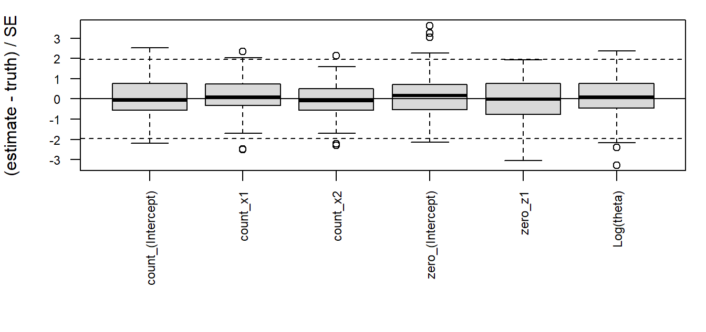
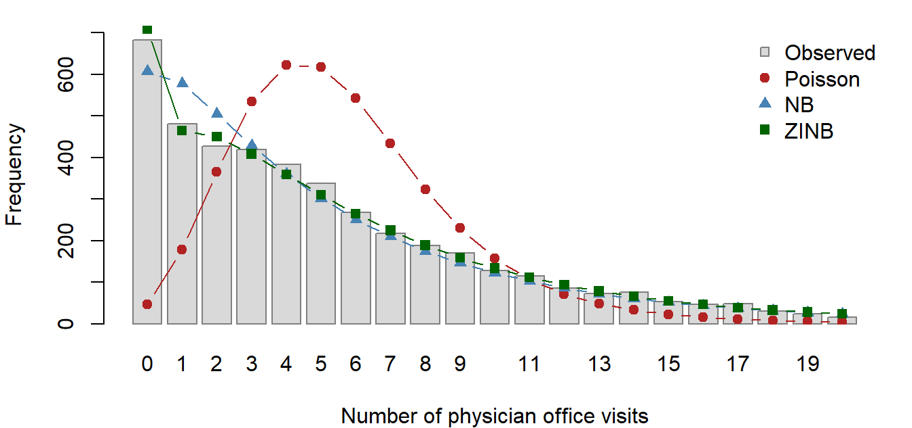

# Negative Binomial and Zero-Inflated Negative Binomial Regression by IRLS and EM

## 1 Introduction

Many outcomes in health, the social sciences and industry are counts:
the number of doctor visits in a year, of articles a student publishes,
of defects on a production line. The Poisson regression model is the
natural starting point, but it forces the variance to equal the mean.
Real count data are often **overdispersed**, with a variance much larger
than the mean, and can also contain **more zeros** than a Poisson model
with the same mean can produce. Ignoring overdispersion gives standard
errors that are too small, and ignoring excess zeros gives a poor
description of who has a zero count and why.

The negative binomial (NB2) model handles overdispersion by adding a
dispersion parameter $`\theta`$, so that
$`\mathrm{Var}(Y)=\mu+\mu^2/\theta`$. The zero-inflated negative
binomial (ZINB) model goes further and treats the data as coming from
two processes: a *structural* process that produces zeros only (for
example, people who never see a doctor), and an NB count process that
can also produce zeros.

The goal of this project is an R package, **nbzinbPate**, that fits both
models with estimation code written from scratch. The NB model is fitted
by iteratively reweighted least squares (IRLS) for the regression
coefficients, alternated with Newton-Raphson for $`\log\theta`$. The
ZINB model, whose likelihood is not that of a generalized linear model,
is fitted by an EM algorithm whose M-steps are IRLS fits. No
general-purpose optimizer
([`optim()`](https://rdrr.io/r/stats/optim.html),
[`nlm()`](https://rdrr.io/r/stats/nlm.html), …) and no GLM fitter
([`glm()`](https://rdrr.io/r/stats/glm.html),
[`lm()`](https://rdrr.io/r/stats/lm.html), …) is used. The package is
checked against
[`MASS::glm.nb()`](https://rdrr.io/pkg/MASS/man/glm.nb.html) and
[`pscl::zeroinfl()`](https://rdrr.io/pkg/pscl/man/zeroinfl.html),
studied in a simulation, and applied to physician office visits in the
NMES1988 data.

## 2 Methods

### 2.1 Models

**NB2.** For counts $`Y_i`$ with covariates $`x_i`$ and offset $`o_i`$,
``` math
P(Y_i = y) = \frac{\Gamma(y+\theta)}{\Gamma(\theta)\, y!}
  \left(\frac{\theta}{\theta+\mu_i}\right)^{\theta}
  \left(\frac{\mu_i}{\theta+\mu_i}\right)^{y},
\qquad \log\mu_i = x_i^\top\beta + o_i,
```
so that $`E(Y_i)=\mu_i`$ and $`\mathrm{Var}(Y_i)=\mu_i+\mu_i^2/\theta`$.
As $`\theta\to\infty`$ the model reduces to the Poisson.

**ZINB.** With probability $`\pi_i`$, where
$`\mathrm{logit}\,\pi_i = z_i^\top\gamma`$, observation $`i`$ is a
structural zero; otherwise it comes from $`\mathrm{NB}(\mu_i,\theta)`$:
``` math
P(Y_i=0)=\pi_i+(1-\pi_i)f_{NB}(0;\mu_i,\theta),\qquad
P(Y_i=y)=(1-\pi_i)f_{NB}(y;\mu_i,\theta),\ y\ge 1,
```
where $`f_{NB}(0;\mu,\theta)=\{\theta/(\theta+\mu)\}^\theta`$. The
observed-data log-likelihood is
``` math
\ell(\beta,\gamma,\theta)=\sum_{y_i=0}\log\!\big[\pi_i+(1-\pi_i)f_{NB}(0;\mu_i,\theta)\big]
+\sum_{y_i>0}\big[\log(1-\pi_i)+\log f_{NB}(y_i;\mu_i,\theta)\big].
```
Because every zero contributes the log of a *sum*, $`\ell`$ is not the
log-likelihood of an exponential-family GLM, and IRLS cannot be applied
to it directly.

### 2.2 NB: IRLS for $`\beta`$ alternated with Newton-Raphson for $`\log\theta`$

**IRLS with $`\theta`$ fixed.** For the log link,
$`\partial\mu/\partial\eta=\mu`$, and $`V(\mu)=\mu+\mu^2/\theta`$.
Fisher scoring is then a weighted least-squares regression of a working
response $`z`$ on $`X`$:
``` math
w_i = a_i\frac{(\partial\mu_i/\partial\eta_i)^2}{V(\mu_i)}=a_i\frac{\theta\mu_i}{\theta+\mu_i},\qquad
z_i = (\eta_i-o_i)+\frac{y_i-\mu_i}{\mu_i},\qquad
\beta^{(t+1)}=(X^\top WX)^{-1}X^\top Wz ,
```
where $`a_i`$ are prior weights ($`a_i=1`$ for an ordinary fit). Each
update is solved by a QR decomposition of $`W^{1/2}X`$, which avoids
forming $`X^\top WX`$ and squaring its condition number.

**Newton-Raphson with $`\beta`$ fixed.** The score and second derivative
of $`\ell`$ in $`\theta`$ are
``` math
U(\theta)=\sum_i a_i\Big[\psi(y_i+\theta)-\psi(\theta)+\log\theta+1-\log(\theta+\mu_i)-\frac{y_i+\theta}{\theta+\mu_i}\Big],
```
``` math
H(\theta)=\sum_i a_i\Big[\psi'(y_i+\theta)-\psi'(\theta)+\frac1\theta-\frac{2}{\theta+\mu_i}+\frac{y_i+\theta}{(\theta+\mu_i)^2}\Big],
```
with $`\psi`$ and $`\psi'`$ the digamma and trigamma functions. The
update is done on $`\phi=\log\theta`$, which keeps $`\theta>0`$; by the
chain rule
``` math
U_\phi=\theta U,\qquad H_\phi=\theta^2H+\theta U,\qquad \phi\leftarrow\phi-U_\phi/H_\phi .
```

**Outer loop.** The fit starts from a Poisson IRLS fit for $`\beta`$
(the same IRLS code with $`\theta=\infty`$, so $`w_i=a_i\mu_i`$) and the
moment estimate $`\theta_0=\sum_i a_i/\sum_i a_i(y_i/\mu_i-1)^2`$, then
alternates the two steps, warm-starting each one at the current values.

**Standard errors.** At convergence,
$`\widehat{\mathrm{Var}}(\hat\beta)=(X^\top\hat WX)^{-1}`$, treating
$`\theta`$ as known as `glm.nb()` does, and
$`\mathrm{SE}(\hat\theta)=\{-H(\hat\theta)\}^{-1/2}`$.

### 2.3 ZINB: EM with IRLS M-steps

Let $`D_i=1`$ if observation $`i`$ is a structural zero. If the $`D_i`$
were observed, the complete-data log-likelihood would split into a
logistic regression for $`D_i`$ and a weighted NB regression with
weights $`1-D_i`$, each of which IRLS can fit. EM replaces $`D_i`$ by
its conditional expectation.

**E-step.** The posterior probability of a structural zero is
``` math
\tau_i=\frac{\pi_i}{\pi_i+(1-\pi_i)f_{NB}(0;\mu_i,\theta)}\ \ (y_i=0),\qquad \tau_i=0\ \ (y_i>0).
```

**M-step, zero part.** Maximize
$`\sum_i[\tau_i\log\pi_i+(1-\tau_i)\log(1-\pi_i)]`$ over $`\gamma`$: a
logistic regression with fractional response $`\tau_i`$, fitted by IRLS
with $`w_i=\pi_i(1-\pi_i)`$ and
$`z_i=z_i^\top\gamma+(\tau_i-\pi_i)/\{\pi_i(1-\pi_i)\}`$. Because the
logit is the canonical link, this IRLS is exact Newton-Raphson.

**M-step, count part.** Maximize
$`\sum_i(1-\tau_i)\log f_{NB}(y_i;\mu_i,\theta)`$ over
$`(\beta,\theta)`$. This is exactly the NB fit above with prior weights
$`a_i=1-\tau_i`$, so the same code is reused.

Both M-steps are run to convergence, warm-started at the previous
values. EM starts from the NB fit for $`(\beta,\theta)`$ and a logistic
IRLS fit of $`I(y_i=0)`$ for $`\gamma`$. Each M-step increases the
expected complete-data log-likelihood, which guarantees that $`\ell`$
never decreases (Dempster, Laird and Rubin, 1977); the code checks this
at every iteration.

### 2.4 Standard errors for ZINB: analytic Hessian

EM does not produce standard errors, so after convergence the observed
information of $`\ell`$ with respect to $`(\beta,\gamma,\log\theta)`$ is
computed analytically and inverted. Writing $`\eta^z_i=z_i^\top\gamma`$,
$`\eta^c_i=x_i^\top\beta+o_i`$,
$`\ell^f_i=\log f_{NB}(y_i;\mu_i,\theta)`$ and
$`a,b\in\{\eta^c,\phi\}`$, the derivatives simplify when expressed
through $`\tau_i`$:
``` math
\frac{\partial\ell_i}{\partial\eta^z_i}=\tau_i-\pi_i,\qquad
\frac{\partial\ell_i}{\partial a}=(1-\tau_i)\frac{\partial\ell^f_i}{\partial a},
```
``` math
\frac{\partial^2\ell_i}{\partial(\eta^z_i)^2}=\tau_i(1-\tau_i)-\pi_i(1-\pi_i),\quad
\frac{\partial^2\ell_i}{\partial\eta^z_i\,\partial a}=-\tau_i(1-\tau_i)\frac{\partial\ell^f_i}{\partial a},
```
``` math
\frac{\partial^2\ell_i}{\partial a\,\partial b}=(1-\tau_i)\frac{\partial^2\ell^f_i}{\partial a\,\partial b}
+\tau_i(1-\tau_i)\frac{\partial\ell^f_i}{\partial a}\frac{\partial\ell^f_i}{\partial b}.
```
These are Louis’ (1982) formula: the observed information equals the
expected complete-data information minus the variance of the
complete-data score, and $`\tau_i(1-\tau_i)=\mathrm{Var}(D_i\mid y_i)`$
is the “missing information”. The NB derivatives
$`\partial\ell^f_i/\partial\eta^c_i=\theta(y_i-\mu_i)/(\theta+\mu_i)`$,
$`\partial^2\ell^f_i/\partial(\eta^c_i)^2=-\theta\mu_i(\theta+y_i)/(\theta+\mu_i)^2`$,
$`\partial^2\ell^f_i/\partial\eta^c_i\partial\phi=\theta\mu_i(y_i-\mu_i)/(\theta+\mu_i)^2`$,
and the $`\phi`$ derivatives $`\theta U_i`$ and
$`\theta U_i+\theta^2H_i`$ come from Section 2.2. The chain rule
($`\partial\eta^c_i/\partial\beta=x_i`$,
$`\partial\eta^z_i/\partial\gamma=z_i`$) assembles the full Hessian
$`H`$, and
$`\widehat{\mathrm{Var}}(\hat\beta,\hat\gamma,\log\hat\theta)=\{-H\}^{-1}`$.
The standard error of $`\hat\theta`$ follows from the delta method,
$`\mathrm{SE}(\hat\theta)=\hat\theta\,\mathrm{SE}(\log\hat\theta)`$.

### 2.5 Convergence criteria and numerical safeguards

The inner IRLS loops stop when no coefficient changes by more than
$`10^{-10}`$, and the Newton loop when $`|\Delta\phi|<10^{-10}`$. A
criterion on the parameters is needed because the log-likelihood is flat
at its maximum: a change in $`\ell`$ of $`10^{-7}`$ can leave $`\beta`$
wrong in the sixth digit, and the NB log link is not canonical, so
Fisher scoring converges only linearly. The NB outer loop stops when
$`\ell`$ changes by less than $`10^{-8}`$*and* the parameters by less
than $`10^{-8}`$; EM stops when $`\ell`$ changes by less than
$`10^{-8}`$ and the parameters by less than $`10^{-6}`$.

Each IRLS or Newton step is halved if it lowers the log-likelihood by
more than rounding error which means it passed the maximum. The steps
are halved until the maximum is not passed. Probabilities are handled on
the log scale (`plogis(eta, log.p = TRUE)` and a log-sum-exp form of
$`\log[\pi+(1-\pi)f_{NB}(0)]`$), so $`\pi_i`$ is never rounded to
exactly 0 or 1. Two boundary cases are detected and reported with a
warning: $`\hat\theta`$ diverging to $`\infty`$ (no overdispersion;
$`\theta`$ is capped at $`10^8`$), and all $`\hat\pi_i\to 0`$ in the
ZINB model (no zero inflation, so the zero-model coefficients diverge to
$`-\infty`$).

## 3 The R package

The package exports two fitting functions, two control functions, and a
full set of S3 methods for each fitted class.

| Function | Purpose |
|:---|:---|
| `nbreg(formula, data, offset, control)` | NB2 regression: IRLS + Newton-Raphson for $`\log\theta`$ |
| `zinbreg(formula, data, offset, control)` | ZINB regression by EM; formula `y ~ x | z` |
| [`nbreg_control()`](https://brandonp8.github.io/nbzinbPate/reference/nbreg_control.md), [`zinbreg_control()`](https://brandonp8.github.io/nbzinbPate/reference/zinbreg_control.md) | tolerances, iteration limits, `trace` |
| S3 methods (both classes) | `print`, `summary`, `coef`, `vcov`, `logLik`, `AIC`/`BIC`, `fitted`, `residuals`, `nobs`, `predict` |

**Design.** Each model has a formula interface
([`nbreg()`](https://brandonp8.github.io/nbzinbPate/reference/nbreg.md),
[`zinbreg()`](https://brandonp8.github.io/nbzinbPate/reference/zinbreg.md))
that builds the design matrices, checks the input and packages the
result, and a matrix-level engine (`nbreg_fit()`, `zinbreg_fit()`) that
only does the estimation. This separation is what makes the EM
count-part M-step a single call to `nbreg_fit()` with prior weights
$`1-\tau_i`$ and a warm start. The two-part formula `y ~ x | z` is split
in base R: a formula is a call, and because `|` binds more loosely than
`+`, its right-hand side is a call to `|` whose two arguments are the
count and zero parts. Without `|`, the same covariates are used in both
parts, as in `zeroinfl()`. Offsets may be given as an argument or as
[`offset()`](https://rdrr.io/r/stats/offset.html) terms in the (count)
formula. The only dependency is base R’s **stats** package.

**Methods.** [`logLik()`](https://rdrr.io/r/stats/logLik.html) returns
an object carrying the number of parameters and observations, so
[`AIC()`](https://rdrr.io/r/stats/AIC.html) and
[`BIC()`](https://rdrr.io/r/stats/AIC.html) work.
[`residuals()`](https://rdrr.io/r/stats/residuals.html) returns response
or Pearson residuals; for ZINB the Pearson residuals use
$`\mathrm{Var}(Y_i)=(1-\pi_i)\mu_i\{1+\mu_i(\pi_i+1/\theta)\}`$.
[`predict()`](https://rdrr.io/r/stats/predict.html) accepts `newdata`
(using the fitted factor levels, contrasts and offset) and, for ZINB,
`type = "response"` ($`(1-\pi)\mu`$), `"count"` ($`\mu`$) or `"zero"`
($`\pi`$).

**Testing.** The `testthat` suite compares both functions with
`glm.nb()` and `zeroinfl()` at the project tolerances on both data sets,
checks the analytic score and Hessian against numerical derivatives,
checks that EM never decreases $`\ell`$, tests offsets, single-covariate
and intercept-only models, the boundary cases and informative errors,
and verifies that no function in the package calls a prohibited
optimizer or fitter. `R CMD check` passes with no errors, warnings or
notes on Windows, macOS and Linux through GitHub Actions. The package is
installed with `devtools::install_github("brandonp8/nbzinbPate")`;
Section 6.2 shows it in use, and the README has a further example.

## 4 Benchmarking

Both functions were compared with the reference implementations on
[`pscl::bioChemists`](https://rdrr.io/pkg/pscl/man/bioChemists.html) and
[`AER::NMES1988`](https://rdrr.io/pkg/AER/man/NMES1988.html), using the
reference functions with tight tolerances
(`glm.control(epsilon = 1e-10)` and `zeroinfl.control(reltol = 1e-12)`).
The script is `inst/benchmark/benchmark.R`.

| Data | Model | Coef. | SE | theta / log theta | logLik | Ours (s) | Ref. (s) | Iter. |
|:---|:---|:---|:---|:---|:---|---:|---:|---:|
| bioChemists | NB | 1.9e-11 | 9.4e-13 | 2.6e-12 | 2.3e-13 | 0.03 | 0.05 | 5 |
| bioChemists | ZINB | 8.9e-06 | 5.4e-06 | 7.2e-07 | 1.6e-10 | 2.36 | 0.16 | 140 |
| NMES1988 | NB | 7.2e-11 | 4.3e-12 | 1.4e-10 | 0.0e+00 | 0.12 | 0.14 | 4 |
| NMES1988 | ZINB | 5.6e-06 | 2.8e-06 | 1.0e-06 | 8.9e-10 | 4.17 | 0.80 | 64 |

Maximum absolute difference from MASS::glm.nb() (NB) and
pscl::zeroinfl() (ZINB), median time, and number of outer (NB) or EM
(ZINB) iterations. Required: at most 1e-5 (NB coefficients and SEs),
1e-4 (NB theta, logLik), 1e-3 (all ZINB). {.table .caption-top
style="width:100%;"}

All quantities meet the required tolerances, by a wide margin. For NB,
the coefficients, standard errors, $`\theta`$ and log-likelihood agree
with `glm.nb()` to within 1.4e-10, essentially machine precision. (The
only slightly larger difference is in $`\mathrm{SE}(\hat\theta)`$, about
1.1e-06:
[`MASS::theta.ml()`](https://rdrr.io/pkg/MASS/man/theta.md.html)
evaluates the information at the $`\theta`$ value before its final
Newton step, while
[`nbreg()`](https://brandonp8.github.io/nbzinbPate/reference/nbreg.md)
evaluates it at $`\hat\theta`$.) For ZINB the largest difference in any
coefficient or standard error is 8.9e-06, and the log-likelihoods agree
to 8.9e-10. On NMES1988 our ZINB log-likelihood is slightly higher than
that of `zeroinfl()`. The complete side-by-side estimates are in the
Appendix.

The NB fits take about as long as `glm.nb()`. The ZINB fits are 5 to 15
times slower than `zeroinfl()`. This is expected. `zeroinfl()` updates
all parameters jointly with a quasi-Newton method (BFGS), which
converges superlinearly, whereas EM converges linearly at a rate set by
the fraction of missing information. The zero component is weakly
identified in bioChemists, so EM needs 140 iterations there, against 64
for the larger NMES1988 data. In addition, every M-step is a fully
converged weighted NB fit.

## 5 Simulation study

To check that
[`zinbreg()`](https://brandonp8.github.io/nbzinbPate/reference/zinbreg.md)
recovers known parameters and that its standard errors are accurate,
$`R=100`$ data sets of size $`n=500`$ were simulated (seed 651, script
`inst/benchmark/simulation.R`) from
$`\log\mu_i=1 + 0.5\,x_{1i} -0.3\,x_{2i}`$ with $`x_1\sim N(0,1)`$ and
$`x_2\sim\mathrm{Bernoulli}(0.5)`$,
$`\mathrm{logit}\,\pi_i=-0.5 + 0.8\,z_{1i}`$ with $`z_1\sim N(0,1)`$,
and $`\theta=1.5`$. Covariates were redrawn for each data set. On
average about 55% of each simulated sample were zeros.

| Parameter          |   True | Mean est. |   Bias | MC SD | Mean SE | SE / MC SD | Coverage |
|:-------------------|-------:|----------:|-------:|------:|--------:|-----------:|---------:|
| count\_(Intercept) |  1.000 |     0.997 | -0.003 | 0.098 |   0.107 |      1.094 |     0.97 |
| count_x1           |  0.500 |     0.509 |  0.009 | 0.060 |   0.067 |      1.111 |     0.95 |
| count_x2           | -0.300 |    -0.311 | -0.011 | 0.114 |   0.131 |      1.145 |     0.97 |
| zero\_(Intercept)  | -0.500 |    -0.526 | -0.026 | 0.273 |   0.240 |      0.879 |     0.94 |
| zero_z1            |  0.800 |     0.833 |  0.033 | 0.222 |   0.191 |      0.862 |     0.96 |
| Log(theta)         |  0.405 |     0.425 |  0.020 | 0.242 |   0.256 |      1.057 |     0.96 |

Simulation results: bias, Monte Carlo SD versus mean estimated SE, and
empirical coverage of 95% Wald intervals (theta on the log scale).
{.table .caption-top}

All 100 fits converged, with 0 boundary cases and no warnings. The
estimates are essentially unbiased: every bias is within 1.50 Monte
Carlo standard errors of zero (the Monte Carlo SE of a mean estimate is
$`\mathrm{SD}/\sqrt{R}`$). The ratio of the mean estimated SE to the
Monte Carlo SD ranges from 0.86 to 1.14. With $`R=100`$, an SD is itself
estimated with a relative error of about $`1/\sqrt{2(R-1)}\approx
7`$%, so these ratios are consistent with 1. The empirical coverage of
the 95% Wald intervals ranges from 0.94 to 0.97, all within two Monte
Carlo standard errors ($`\pm 2\times0.022`$) of 0.95. This also provides
an independent check of the analytic Hessian: errors in the second
derivatives would show up as SE ratios far from 1. The standardized
errors in the figure below are centred at 0 with roughly unit spread.

The only visible pattern is that the zero-part SEs are somewhat smaller
than the Monte Carlo SDs (ratios 0.86 and 0.88), while the count-part
SEs are slightly larger. With $`R=100`$ these deviations are not
statistically significant, but a slight underestimation of uncertainty
in the weakly identified zero component at $`n=500`$ is plausible.



Standardized errors (estimate - truth) / SE across the 100 replications.
Under correct SEs these are approximately N(0, 1); dashed lines at
+/-1.96.

## 6 Data analysis: NMES1988

The NMES1988 data (Deb and Trivedi, 1997; available in the **AER**
package) record the number of physician office visits (`visits`) for
4,406 individuals aged 66 and over in the US National Medical
Expenditure Survey, 1987-88. The covariates used are the number of
hospital stays (`hospital`), self-perceived health (`health`: poor,
average or excellent), the number of chronic conditions (`chronic`),
`gender`, years of education (`school`), and whether the individual has
private insurance (`insurance`).

### 6.1 Descriptive summary

|    n |  Mean | Variance | Var./mean | Zeros | Prop. zero | Poisson P(0) |
|-----:|------:|---------:|----------:|------:|-----------:|-------------:|
| 4406 | 5.774 |   45.687 |     7.912 |   683 |      0.155 |        0.003 |

Physician office visits in NMES1988. Poisson P(0): probability of a zero
under a Poisson distribution with the sample mean. {.table .caption-top}

The number of visits ranges from 0 to 89, with mean 5.77 and variance
45.69: the variance is 7.9 times the mean, far from the equality the
Poisson model requires. There are also many more zeros than a Poisson
distribution allows: 683 individuals (15.5%) made no office visit, while
a Poisson distribution with the same mean gives a zero with probability
0.003, i.e. about 14 zeros. The covariates explain part of this, so the
fitted models below give a fairer comparison, but the data clearly show
overdispersion and excess zeros.

### 6.2 Models

``` r

f_count <- visits ~ hospital + health + chronic + gender + school + insurance
f_zinb  <- visits ~ hospital + health + chronic + gender + school + insurance |
  hospital + chronic + gender + school + insurance

m_pois <- glm(f_count, family = poisson, data = d)   # reference Poisson model
m_nb   <- nbreg(f_count, data = d)                     # our NB
m_zinb <- zinbreg(f_zinb, data = d)                    # our ZINB
```

The count part uses all six covariates. The zero part uses the minimum
set required by the project (all covariates except self-perceived
health). The Poisson model is fitted with
[`glm()`](https://rdrr.io/r/stats/glm.html) for reference only.



Observed frequencies of office visits (bars) and frequencies expected
under the fitted Poisson, NB and ZINB models, for 0-20 visits.

### 6.3 Model comparison

| Model   |  df |   logLik |     AIC |     BIC | Expected zeros |
|:--------|----:|---------:|--------:|--------:|---------------:|
| Poisson |   8 | -17971.6 | 35959.2 | 36010.4 |           46.7 |
| NB      |   9 | -12170.6 | 24359.1 | 24416.6 |          608.0 |
| ZINB    |  15 | -12090.7 | 24211.4 | 24307.3 |          708.9 |

Model comparison for NMES1988 (observed zeros = 683). {.table
.caption-top}

The Poisson model fits very poorly. It predicts only 47 zeros against
683 observed, and its log-likelihood is 5801 units below that of the NB
model, for a single extra parameter. In the figure, it puts far too much
mass at 3-8 visits and too little at 0-2 and in the right tail. Allowing
overdispersion fixes most of this: the NB model has $`\hat\theta=1.207`$
(SE 0.034), and its predicted frequencies follow the observed ones
closely from about 3 visits upward.

The NB model still **under-predicts** the zeros (608 expected against
683 observed) and **over-predicts** single visits (578 against 481). The
ZINB model corrects both (709 zeros and 465 single visits); it slightly
over-predicts the zeros, by 26. It improves the log-likelihood by 79.8
with 6 extra parameters, and has both the lowest AIC (24211.4 against
24359.1 for NB) and the lowest BIC (24307.3 against 24416.6). Unlike the
bioChemists example, where BIC preferred the simpler NB model, here both
criteria favour zero inflation. Once the structural zeros are modelled
separately, the count component is also less overdispersed
($`\hat\theta=1.483`$ in the ZINB model).

### 6.4 Interpretation: incidence rate ratios and odds ratios

| Covariate       |  NB IRR (95% CI)  | ZINB count IRR (95% CI) |
|:----------------|:-----------------:|:-----------------------:|
| hospital        | 1.24 (1.20, 1.29) |    1.22 (1.18, 1.27)    |
| healthpoor      | 1.36 (1.23, 1.49) |    1.33 (1.22, 1.45)    |
| healthexcellent | 0.71 (0.63, 0.80) |    0.73 (0.65, 0.82)    |
| chronic         | 1.19 (1.16, 1.22) |    1.14 (1.11, 1.16)    |
| gendermale      | 0.88 (0.83, 0.94) |    0.92 (0.87, 0.98)    |
| school          | 1.03 (1.02, 1.04) |    1.02 (1.01, 1.03)    |
| insuranceyes    | 1.25 (1.16, 1.35) |    1.13 (1.05, 1.23)    |

Count part: incidence rate ratios with 95% Wald intervals. The reference
health category is average (the contrasts supplied with the AER data).
{.table .caption-top}

| Covariate    |    OR (95% CI)    | p-value |
|:-------------|:-----------------:|:-------:|
| hospital     | 0.45 (0.20, 1.02) | 0.0571  |
| chronic      | 0.29 (0.20, 0.41) | \<1e-04 |
| gendermale   | 1.91 (1.29, 2.83) | 0.0012  |
| school       | 0.92 (0.87, 0.97) | 0.0014  |
| insuranceyes | 0.31 (0.20, 0.48) | \<1e-04 |

ZINB zero part: odds ratios of being a structural zero (never visiting),
with 95% Wald intervals. {.table .caption-top}

All effects below hold the other covariates fixed.

**NB model.** Every covariate is associated with the number of visits at
the 5% level. Each additional hospital stay is associated with 24% more
office visits (IRR 1.24), and each additional chronic condition with 19%
more. Compared with individuals in average health, those in poor health
make 36% more visits and those in excellent health 29% fewer. Men make
12% fewer visits than women, each year of education is associated with
3% more visits, and private insurance with 25% more.

**ZINB model, count part.** This part describes individuals who are “at
risk” of visiting a doctor. The directions and significance of all
effects match the NB model, and the health and hospital effects are
almost unchanged (IRR 1.22 per hospital stay; 1.33 and 0.73 for poor and
excellent health). The effects of chronic conditions (IRR 1.19 to 1.14),
insurance (1.25 to 1.13) and gender (0.88 to 0.92) move toward 1,
although all remain significant. In the NB model these covariates
combine two effects: whether someone sees a doctor at all, and how
often. The ZINB model separates the two, and part of their association
turns out to act through the first.

**ZINB model, zero part.** The zero part models the probability of being
a structural zero, an individual who would not visit a physician
regardless. Each additional chronic condition multiplies the odds of
being such a non-user by 0.29, a 71% reduction, and private insurance
multiplies them by 0.31 (69% lower odds). Men have 1.91 times the odds
of women of being non-users, and each additional year of education
lowers the odds by 8%. Hospital stays point in the same direction (OR
0.45), but this effect is not significant at the 5% level (p = 0.057).
These effects are plausible: people with chronic conditions have a
reason to see a doctor, and people with private insurance face lower
costs of doing so.

**Preferred model.** I prefer the ZINB model for these data. It has the
lowest AIC *and* BIC, it reproduces the observed numbers of zeros and
single visits much better than the NB model, and its two parts have a
clear and useful interpretation. Chronic illness, insurance, gender and
education are associated both with *whether* an elderly person sees a
physician at all and with *how often* among those who do, while the
effect of hospital stays acts mainly on how often. (Self-perceived
health was included in the count part only, so its role in non-use was
not assessed.) The NB model is not wrong (all its effects have the same
signs), but it mixes these two processes, and the comparison shows that
the data support separating them.

## 7 Discussion

The package reproduces `glm.nb()` and `zeroinfl()` to far better than
the required tolerances, using only IRLS, Newton-Raphson and EM. The
simulation confirms that the ZINB estimates are unbiased and that the
analytic-Hessian standard errors give close to nominal coverage. Several
limitations remain.

- **Speed.** EM converges linearly, so
  [`zinbreg()`](https://brandonp8.github.io/nbzinbPate/reference/zinbreg.md)
  is 5-15 times slower than `zeroinfl()`. Running each M-step to full
  convergence is also conservative. Loosening the M-step tolerance
  roughly halves the run time without changing the estimates, and EM
  acceleration (for example SQUAREM) could reduce the number of
  iterations further, although it needs extra safeguards to keep the
  log-likelihood monotone.
- **NB standard errors.** Following `glm.nb()`,
  $`\mathrm{Var}(\hat\beta)`$ treats $`\theta`$ as known. Because
  $`\beta`$ and $`\theta`$ are asymptotically orthogonal in the NB2
  model, this costs little, but the full observed information would be
  more exact in small samples.
- **Weak identification.** When the zero component is weakly identified
  (large zero-part SEs, as in bioChemists), EM needs many iterations and
  the Wald intervals for $`\gamma`$ may be somewhat too narrow, as the
  simulation hints. Profile-likelihood intervals would be more reliable
  there.
- **Boundary cases.** When the data show no zero inflation, the MLE of
  $`\gamma`$ is at $`-\infty`$. The package detects this and warns, but
  it does not provide a formal test of zero inflation.
- **Extensions.** Natural extensions are zero-inflated Poisson and
  hurdle models, other links for the zero part (for example the probit),
  prior weights in
  [`zinbreg()`](https://brandonp8.github.io/nbzinbPate/reference/zinbreg.md),
  offsets in the zero model, and a test comparing the NB and ZINB
  models.

## 8 AI-use statement

Claude Code was used to generate all code and to draft the report. I
gave it clear step by step instructions on how to implement the package
as well as rules it must follow like not using optim() or other
functions. After each step and then again after completion I
double-checked its work. I had to make a few corrections to its work.
For instance, at first the stopping rule for the IRLS was based on
log-likelihood change which converged before beta converged. This is
because the likelihood is nearly flat at its peak and the NB IRLS
algorithm converges only linearly. I corrected this by having the
algorithm stop when beta itself stopped changing.

## 9 References

- Cameron, A. C. and Trivedi, P. K. (2013). *Regression Analysis of
  Count Data* (2nd ed.). Cambridge University Press.
- Deb, P. and Trivedi, P. K. (1997). Demand for medical care by the
  elderly: A finite mixture approach. *Journal of Applied Econometrics*,
  12(3), 313-336.
- Dempster, A. P., Laird, N. M. and Rubin, D. B. (1977). Maximum
  likelihood from incomplete data via the EM algorithm. *JRSS-B*, 39(1),
  1-38.
- Lambert, D. (1992). Zero-inflated Poisson regression, with an
  application to defects in manufacturing. *Technometrics*, 34(1), 1-14.
- Long, J. S. (1997). *Regression Models for Categorical and Limited
  Dependent Variables*. Sage.
- Louis, T. A. (1982). Finding the observed information matrix when
  using the EM algorithm. *JRSS-B*, 44(2), 226-233.
- McCullagh, P. and Nelder, J. A. (1989). *Generalized Linear Models*
  (2nd ed.). Chapman & Hall.
- Venables, W. N. and Ripley, B. D. (2002). *Modern Applied Statistics
  with S* (4th ed.). Springer.
- Wickham, H. and Bryan, J. (2023). *R Packages* (2nd ed.). O’Reilly.
  <https://r-pkgs.org>
- Zeileis, A., Kleiber, C. and Jackman, S. (2008). Regression models for
  count data in R. *Journal of Statistical Software*, 27(8), 1-25.

## 10 Appendix: side-by-side benchmark estimates

| Quantity        | Parameter   |   nbzinbPate |    Reference | Abs. difference |
|:----------------|:------------|-------------:|-------------:|:----------------|
| Coefficients    | (Intercept) |     0.256144 |     0.256144 | 1.9e-11         |
| Coefficients    | femWomen    |    -0.216418 |    -0.216418 | 4.1e-12         |
| Coefficients    | marMarried  |     0.150489 |     0.150489 | 2.4e-12         |
| Coefficients    | kid5        |    -0.176415 |    -0.176415 | 3.9e-12         |
| Coefficients    | phd         |     0.015271 |     0.015271 | 7.2e-13         |
| Coefficients    | ment        |     0.029082 |     0.029082 | 1.6e-12         |
| Standard errors | (Intercept) |     0.137348 |     0.137348 | 9.4e-13         |
| Standard errors | femWomen    |     0.072636 |     0.072636 | 4.0e-13         |
| Standard errors | marMarried  |     0.082097 |     0.082097 | 5.1e-13         |
| Standard errors | kid5        |     0.052813 |     0.052813 | 2.3e-13         |
| Standard errors | phd         |     0.035873 |     0.035873 | 2.1e-13         |
| Standard errors | ment        |     0.003214 |     0.003214 | 1.7e-14         |
| theta           | theta       |     2.264388 |     2.264388 | 2.6e-12         |
| SE(theta)       | SE(theta)   |     0.271176 |     0.271175 | 1.1e-06         |
| Log-likelihood  | logLik      | -1560.958338 | -1560.958338 | 2.3e-13         |

bioChemists, NB: nbzinbPate vs MASS::glm.nb(). {.table .caption-top}

| Quantity        | Parameter          |   nbzinbPate |    Reference | Abs. difference |
|:----------------|:-------------------|-------------:|-------------:|:----------------|
| Coefficients    | count\_(Intercept) |     0.416747 |     0.416747 | 1.8e-07         |
| Coefficients    | count_femWomen     |    -0.195507 |    -0.195507 | 1.5e-07         |
| Coefficients    | count_marMarried   |     0.097583 |     0.097583 | 6.3e-08         |
| Coefficients    | count_kid5         |    -0.151732 |    -0.151732 | 1.1e-07         |
| Coefficients    | count_phd          |    -0.000700 |    -0.000700 | 2.6e-08         |
| Coefficients    | count_ment         |     0.024786 |     0.024786 | 1.9e-08         |
| Coefficients    | zero\_(Intercept)  |    -0.191696 |    -0.191688 | 7.3e-06         |
| Coefficients    | zero_femWomen      |     0.635933 |     0.635933 | 2.8e-07         |
| Coefficients    | zero_marMarried    |    -1.499460 |    -1.499468 | 8.9e-06         |
| Coefficients    | zero_kid5          |     0.628426 |     0.628427 | 1.1e-06         |
| Coefficients    | zero_phd           |    -0.037713 |    -0.037715 | 1.5e-06         |
| Coefficients    | zero_ment          |    -0.882289 |    -0.882293 | 4.6e-06         |
| Standard errors | count\_(Intercept) |     0.143596 |     0.143597 | 3.3e-07         |
| Standard errors | count_femWomen     |     0.075593 |     0.075593 | 8.9e-09         |
| Standard errors | count_marMarried   |     0.084452 |     0.084452 | 4.6e-09         |
| Standard errors | count_kid5         |     0.054206 |     0.054206 | 8.3e-09         |
| Standard errors | count_phd          |     0.036270 |     0.036270 | 8.1e-08         |
| Standard errors | count_ment         |     0.003492 |     0.003493 | 2.5e-07         |
| Standard errors | zero\_(Intercept)  |     1.322815 |     1.322819 | 3.8e-06         |
| Standard errors | zero_femWomen      |     0.848914 |     0.848918 | 4.0e-06         |
| Standard errors | zero_marMarried    |     0.938665 |     0.938671 | 5.4e-06         |
| Standard errors | zero_kid5          |     0.442781 |     0.442783 | 1.5e-06         |
| Standard errors | zero_phd           |     0.308007 |     0.308008 | 8.8e-07         |
| Standard errors | zero_ment          |     0.316226 |     0.316228 | 2.6e-06         |
| log(theta)      | log(theta)         |     0.976357 |     0.976357 | 7.2e-07         |
| SE(log theta)   | SE(log theta)      |     0.135468 |     0.135469 | 1.5e-06         |
| Log-likelihood  | logLik             | -1549.990887 | -1549.990887 | 1.6e-10         |

bioChemists, ZINB: nbzinbPate vs pscl::zeroinfl(). {.table .caption-top
style="width:100%;"}

| Quantity        | Parameter       |    nbzinbPate |     Reference | Abs. difference |
|:----------------|:----------------|--------------:|--------------:|:----------------|
| Coefficients    | (Intercept)     |      0.929257 |      0.929257 | 5.8e-11         |
| Coefficients    | hospital        |      0.217772 |      0.217772 | 7.2e-11         |
| Coefficients    | healthpoor      |      0.305013 |      0.305013 | 3.8e-11         |
| Coefficients    | healthexcellent |     -0.341807 |     -0.341807 | 2.1e-11         |
| Coefficients    | chronic         |      0.174916 |      0.174916 | 1.7e-11         |
| Coefficients    | gendermale      |     -0.126488 |     -0.126488 | 9.2e-12         |
| Coefficients    | school          |      0.026815 |      0.026815 | 7.2e-13         |
| Coefficients    | insuranceyes    |      0.224402 |      0.224402 | 2.1e-12         |
| Standard errors | (Intercept)     |      0.054591 |      0.054591 | 3.9e-12         |
| Standard errors | hospital        |      0.020176 |      0.020176 | 5.8e-13         |
| Standard errors | healthpoor      |      0.048511 |      0.048511 | 2.4e-12         |
| Standard errors | healthexcellent |      0.060924 |      0.060924 | 4.3e-12         |
| Standard errors | chronic         |      0.012092 |      0.012092 | 7.4e-13         |
| Standard errors | gendermale      |      0.031216 |      0.031216 | 2.2e-12         |
| Standard errors | school          |      0.004394 |      0.004394 | 3.1e-13         |
| Standard errors | insuranceyes    |      0.039464 |      0.039464 | 2.7e-12         |
| theta           | theta           |      1.206604 |      1.206604 | 1.4e-10         |
| SE(theta)       | SE(theta)       |      0.033555 |      0.033555 | 4.2e-07         |
| Log-likelihood  | logLik          | -12170.553598 | -12170.553598 | 0.0e+00         |

NMES1988, NB: nbzinbPate vs MASS::glm.nb(). {.table .caption-top}

| Quantity | Parameter | nbzinbPate | Reference | Abs. difference |
|:---|:---|---:|---:|:---|
| Coefficients | count\_(Intercept) | 1.193713 | 1.193713 | 5.7e-07 |
| Coefficients | count_hospital | 0.201477 | 0.201477 | 2.6e-08 |
| Coefficients | count_healthpoor | 0.285133 | 0.285133 | 8.9e-08 |
| Coefficients | count_healthexcellent | -0.319336 | -0.319336 | 2.0e-07 |
| Coefficients | count_chronic | 0.129000 | 0.129000 | 1.5e-07 |
| Coefficients | count_gendermale | -0.080277 | -0.080277 | 1.5e-07 |
| Coefficients | count_school | 0.021423 | 0.021423 | 2.4e-08 |
| Coefficients | count_insuranceyes | 0.125863 | 0.125864 | 2.5e-07 |
| Coefficients | zero\_(Intercept) | -0.046884 | -0.046879 | 5.6e-06 |
| Coefficients | zero_hospital | -0.800487 | -0.800483 | 3.3e-06 |
| Coefficients | zero_chronic | -1.247933 | -1.247938 | 5.4e-06 |
| Coefficients | zero_gendermale | 0.647678 | 0.647678 | 4.6e-07 |
| Coefficients | zero_school | -0.083770 | -0.083771 | 6.6e-07 |
| Coefficients | zero_insuranceyes | -1.175611 | -1.175615 | 4.2e-06 |
| Standard errors | count\_(Intercept) | 0.056661 | 0.056661 | 1.6e-07 |
| Standard errors | count_hospital | 0.020360 | 0.020360 | 8.3e-09 |
| Standard errors | count_healthpoor | 0.045093 | 0.045093 | 2.9e-09 |
| Standard errors | count_healthexcellent | 0.060405 | 0.060405 | 6.4e-09 |
| Standard errors | count_chronic | 0.011931 | 0.011931 | 5.7e-09 |
| Standard errors | count_gendermale | 0.031024 | 0.031024 | 8.5e-09 |
| Standard errors | count_school | 0.004358 | 0.004358 | 2.0e-08 |
| Standard errors | count_insuranceyes | 0.041588 | 0.041588 | 9.6e-09 |
| Standard errors | zero\_(Intercept) | 0.268561 | 0.268558 | 2.8e-06 |
| Standard errors | zero_hospital | 0.420817 | 0.420816 | 7.2e-07 |
| Standard errors | zero_chronic | 0.178316 | 0.178316 | 5.9e-07 |
| Standard errors | zero_gendermale | 0.200114 | 0.200115 | 7.8e-07 |
| Standard errors | zero_school | 0.026254 | 0.026253 | 7.1e-07 |
| Standard errors | zero_insuranceyes | 0.220119 | 0.220121 | 2.1e-06 |
| log(theta) | log(theta) | 0.394144 | 0.394143 | 1.0e-06 |
| SE(log theta) | SE(log theta) | 0.035035 | 0.035035 | 9.3e-08 |
| Log-likelihood | logLik | -12090.722012 | -12090.722012 | 8.9e-10 |

NMES1988, ZINB: nbzinbPate vs pscl::zeroinfl(). {.table .caption-top}
